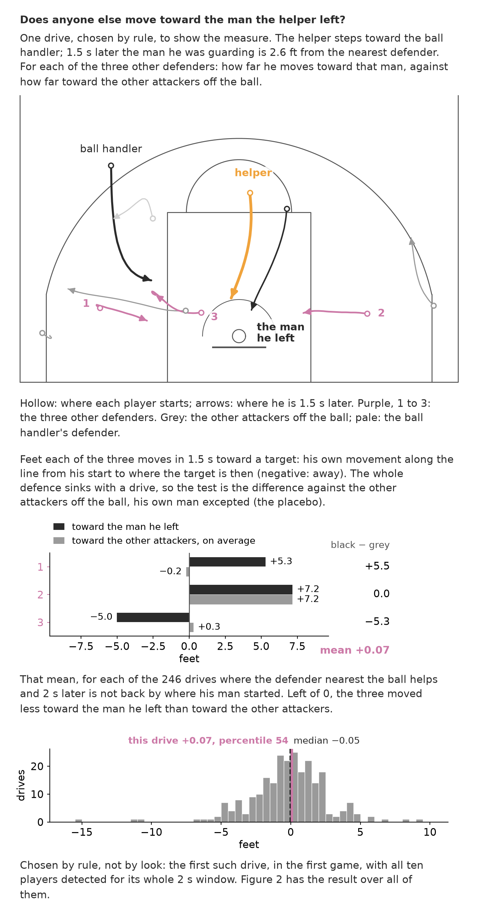
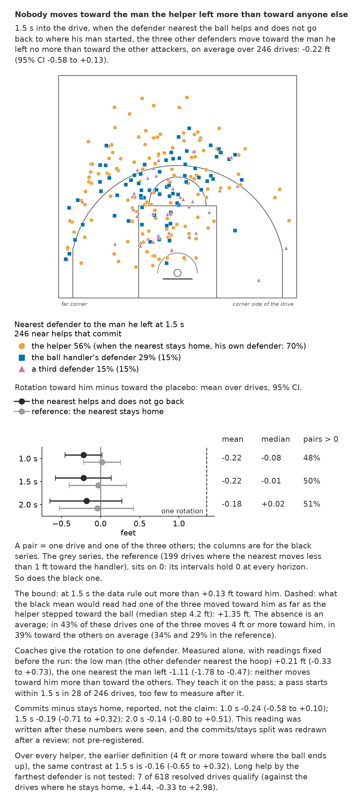

# Nobody helps the helper

Here "nobody" is an average: after the defender nearest the ball steps toward a driving ball handler and does not go back, the other three defenders move toward the man he left no more than toward any other attacker. Ten SkillCorner basketball games, tracked positions, an entry for the PySport x SkillCorner Analytics Cup 2.0. Everything is a displacement or a distance; nothing says why anyone moved.

The page: [javiersr1996.github.io/nobody-helps-the-helper](https://javiersr1996.github.io/nobody-helps-the-helper/). One drive in 3D, then every measure drawn from above; only floor positions are tracked.

## How it is measured

A near help that commits: the off-ball defender nearest the ball moves at least 2 ft toward the handler within 1.0 s and, at 2.0 s, stands more than 1 ft farther from where his man started than at the start. Only the helper's own movement decides. There are **246 of 618** resolved drives like that. The man left is the attacker he marked at the start (the provider's matchups). For each of the other three defenders: his displacement projected toward the man left, minus the same projected toward the placebo, the other off-ball attackers who are not his own man. Negative means more toward the others.

The reference: the nearest defender moves less than 1 ft toward the handler (**199** drives). In figure 1's drive, chosen by a fixed rule, the man left is **2.6 ft** from the nearest defender at 1.5 s.



*Figure 1. One drive chosen by a fixed rule, not by eye: the helper, the man he leaves, and the three others' movement toward him and toward the placebo.*

## The result

At 1.5 s the mean paired difference of the other three is **-0.22 ft** (CI **-0.58 to +0.13**): no more toward the man left than toward the others. The bound is the interval's top: the data rule out more than **+0.13 ft**. For scale, the helpers' median step toward the ball is **4.2 ft**; had one of the three moved toward the man left that far, the mean would read **+1.35 ft**. At 1.0 s it is **-0.22 ft** (CI **-0.46 to +0.01**), at 2.0 s **-0.18 ft** (CI **-0.65 to +0.27**). When the nearest stays home: **-0.03 ft** (CI **-0.41 to +0.33**). Committed minus reference, reported and not claimed: **-0.19 ft** (CI **-0.71 to +0.32**).

Coaches give this rotation to one defender and teach it on the pass (`docs/research/`). Two readings were committed before running (`83e8d5d`): alone, the low man (the other defender nearest the hoop) reads **+0.21 ft** (CI **-0.33 to +0.73**), and the one nearest the man left **-1.11 ft** (CI **-1.78 to -0.47**). Neither moves toward him more. A pass starts within 1.5 s in only **28 of 246** drives, too few to measure what follows: the window mostly sees the defence before any pass.

The absence is an average. In **43 %** of these drives one of the three moves 4 ft or more toward the man left, and in **39 %** toward the others on average (**34 %** and **29 %** in the reference). At 1.5 s a third defender is the nearest to the man left in **15 %** (**15 %** in the reference).



*Figure 2. Where the man left stands at 1.5 s and which defender is nearest; the three others' movement toward him, beside the reference and one rotation's size.*

## How solid it is

Not pre-registered: these numbers were seen before the claim was written. The scope was narrowed to near help after the first near/long results (`bd6033b`, `6bebf5d`, `4b57ff5`). An adversarial review then found that the old committed/stays split read where the man left stood at 2.0 s, the very point the measure aims at; under it the claim was a contrast of **-0.63 ft** (CI **-1.25 to -0.03**), now withdrawn.

The committed interval holds 0 under every check: all **48** combinations of the three thresholds (CI tops **+0.08 to +0.35**), each game left out (means **-0.34 to -0.12**), games resampled (CI **-0.51 to +0.11**), no pass in the first 1.5 s (**-0.21 ft**), every player detected (**-0.13 ft**). With targets fixed where they stood at the start it falls to **-0.81 ft** (CI **-1.15 to -0.48**), but so does the reference (**-0.43 ft**): that variant leans negative on its own.

To our knowledge this has not been measured from tracking; related work infers matchups (Franks et al. 2015; Keshri et al. 2019), detects drive-time defensive gaps (Supola et al. 2023) and links defensive role swaps to open shots (Lucey et al. 2014).

## Limits

- Long help, when the defender farthest from the ball jumps into the drive's path: **7** of 618 drives. Against drives where he stays home, the other three move toward his man **+1.44 ft** more (CI **-0.33 to +2.98**): the direction coaches teach, on too few drives.
- Who guards whom is the provider's table, unvalidated. Its handler defender is the nearest defender in **519 of 595** assigned drives. The helper is the defender closest to his own man at the start in **146 of 246** committed drives (**121 of 199** in the reference).
- The rotation after the pass (the X-out) cannot be judged: n = **18** closeouts land on a man left.
- The drive frame mirrors drives by the handler's lateral motion; the provider's direction label agrees with it on **67 %** of left-labelled and **72 %** of right-labelled drives.
- Ten games; extrapolated positions are less precise than detected ones.

## What ships

`scbasket` (`help_kinds`, `wind`, `rotation`), the scripts writing every number to `reports/*.csv`, the figures, the page and the tests. `scripts/check_readme.py` recomputes every bold number here from its CSV. The rebound entry is in `docs/bounce/`.

## Run it

### From the committed CSVs (no dataset needed)

```bash
uv sync --extra dev
uv run pytest -q
uv run --extra figures python scripts/help_figures.py
uv run python scripts/wind_html.py
npm install -g docx
NODE_PATH="$(npm root -g)" node docs/memoria/build_memoria.js
uv run python scripts/check_readme.py
```

### Full pipeline (needs the dataset)

```bash
uv run python scripts/fetch_data.py          # ~730 MB, needs git-lfs
uv run python scripts/build_frame_cache.py
uv run python scripts/help_wind.py
uv run python scripts/second_help.py
uv run python scripts/help_kinds.py
uv run python scripts/near_robustness.py
uv run python scripts/matchup_check.py
uv run python scripts/wind_scenes.py
```

## Licence

MIT, both ways: this repository (`LICENSE`) and SkillCorner's [opendata-basketball](https://github.com/SkillCorner/opendata-basketball), downloaded, not versioned here.
