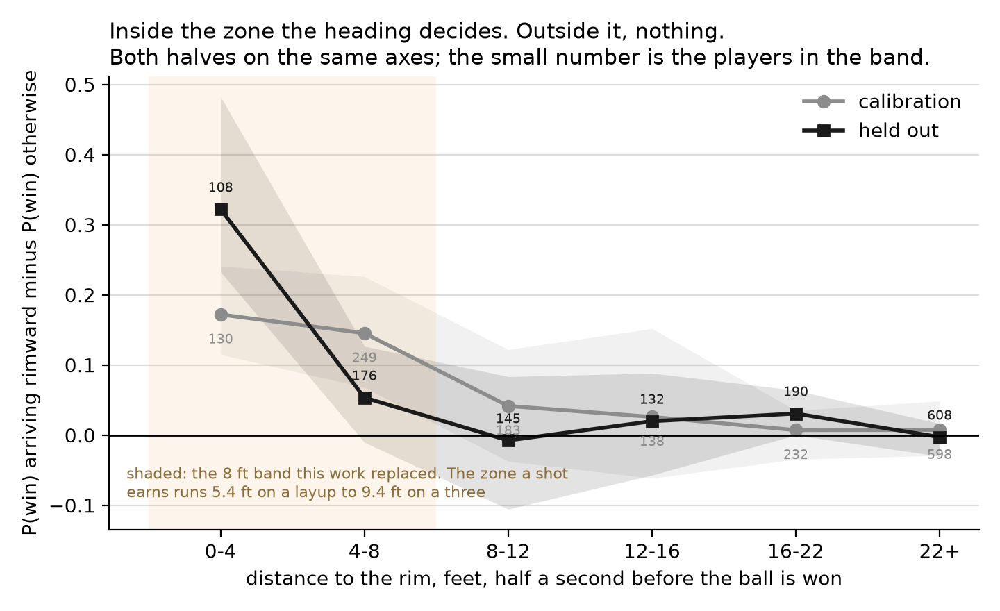
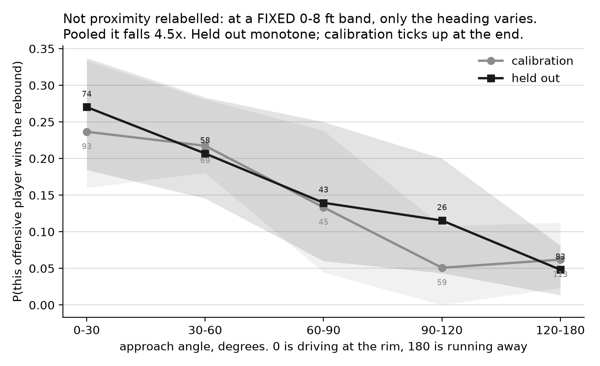

# Nobody reads the bounce

**The eight feet where the rebound is decided**, on SkillCorner's open broadcast tracking of
the Liga ACB 2025-26.

**Thesis: the rebound is not read, it is occupied.**

**The ball is barely legible, and only to a camera.** Knowing where the shot came from cuts
the spread of where it lands by 2.6% (sd 4.73 to 4.60 ft fitted, 4.84 to 4.70 on five games
never touched). The angle the ball arrives at, recovered here from broadcast tracking as it
falls through rim height, is the only other thing that helps:
another 7.1% fitted and 4.0% held out, with a rank correlation against the landing radius of
-0.330 and **-0.353**, negative in five of five games in **both** halves. A flatter ball
carries further. And after all of that the landing point still has a spread of **4.5 ft**,
most of the zone. The angle is measured after the fact: nothing here says a player can use it
in the half second they get.

**What a player controls is their heading, inside a small zone.** Within 4 ft of the rim,
arriving rimward (under 60 deg) lifts the chance of winning the board by **+0.172** on
the five calibration games and **+0.322** on the five held out. Past 12 ft it is worth nothing.

So rebounding is not a reading contest but an occupation contest, and it replicates on five
games never touched.

## The two figures



Both halves on the same axes: the replication is the argument. Intervals are a cluster
bootstrap over the five games of each half, not over rebounds: those are not independent inside
a game, and five clusters is few, so the bands are crude.



The control. Players arriving rimward are also nearer, so figure 1 alone cannot separate
heading from proximity. At a fixed distance, varying only the angle, P(win) falls 4.5x, 0.251
to 0.056 pooled. Split, the held-out half is monotone and calibration ticks up at the end;
the figure says so.

## How it was tested

Ten games, split once, never pooled: **calibration** 114243, 114234, 114169, 114099, 114086;
**held out** 178442, 179612, 184439, 188630, 191313. Every parameter and every pass/fail
criterion was frozen and committed before a held-out game was opened (`1e670ea`, `194f5c6`,
`cdb3cd5`).

**The shot-scaled zone.** r(d) = 5.40 + 0.180·d feet, d the shot's distance to the rim, fitted
by pinball loss at q = 0.75 on 325 located calibration rebounds. Held out it holds coverage
0.760 and cuts the drift across shot-distance bands to 0.039, against the constant 8 ft band's
0.168: it does not cover more ground, it covers it more evenly. Rebounds land a median
4.81 / 4.93 ft from the rim, and the radius scales with the shot: Spearman +0.336 / +0.367.

**Who wins among the ten present.** Exactly one of ten wins each rebound, so ten independent
probabilities is the wrong structure. A conditional logit over the ten on court, scored half a
second before the ball is won, on distance in units of the zone its shot earned, heading, speed
and team. Coefficients frozen on calibration, not refitted. On 285 graded held-out rebounds it
puts **-1.829** of log probability per rebound on the player who won, against the
distance-only model's -1.912, and the gain holds in **five games of five**.

## The negatives, which are part of the claim

- **This repository overturned one of its own findings.** Earlier work called the ball useless
  (+0.018 against the landing radius), from an exploration that left no code behind. Rebuilt as
  code, the sign reverses and replicates.
- **The model's top-1 accuracy is a pooled artefact.** 0.263 against the nearest-to-the-rim
  rule's 0.246 passed as pre-registered, but holds in three games of five and amounts to
  five rebounds of 285. The claim rests on the log probability, which holds in all five.
- **One pre-registered condition was retired, not moved.** It asked the scaled zone to carry no
  more mean area than the constant one at equal coverage. Area is quadratic in the radius, so
  no scaled zone could pass it, and it was already failing on the half it was written from. The
  verdict reads "passes the two conditions that can discriminate", never "passed".
- **The side bias does not reproduce Goldsberry (2014).** Share landing opposite the shooter's
  side: threes 0.504 / 0.539, inside 16 ft 0.424 / 0.477. His directions survive, weakly;
  his 56% does not, under a definition with no free parameter in it.
- **Defensive help does not leave you badly placed to rebound.** Four probes, all negative;
  the direction closed in an afternoon. No code ships from it, so no number from it is quoted
  here: the detail is in `tasks/todo.md`.

## What ships

`scbasket` is the derived layer the open bundle does not carry. `approach_angles` (heading and
speed half a second before the ball is won), `zone_radius` and `rebound_zone_table` (the
shot-scaled zone), `ball_entry_table` (how steeply the ball arrives, before it touches
anything) and `scbasket.conditional` (the contest among the ten). Published as a
**definition, never a detector**: it measures vectors, not intentions, as
SkillCorner itself says. Nothing here says a player crashed, tagged up or boxed out.

## Run it

```bash
uv sync --extra dev
python scripts/fetch_data.py                            # ~730 MB, needs git-lfs
uv run python scripts/build_frame_cache.py
uv run python scripts/rebound_zone.py                   # --fit re-derives the zone
uv run python scripts/rebound_contest.py                # --fit re-derives the betas
uv run python scripts/rebound_flight.py                 # --fit reads calibration only
uv run python scripts/angle_tradeoff.py
uv run --extra figures python scripts/figures.py
uv run pytest                    # 225 pass; 14 need the dataset, 1 the forward extra
```

Every number above lands in a `reports/*.csv`. The package runs on pandas and numpy;
matplotlib and scikit-learn are optional.

## Data and licence

MIT, both ways: this repository and SkillCorner's
[opendata-basketball](https://github.com/SkillCorner/opendata-basketball), downloaded, not
versioned here. Dependencies are BSD or MIT.
Entry for the PySport x SkillCorner Analytics Cup 2.0.
